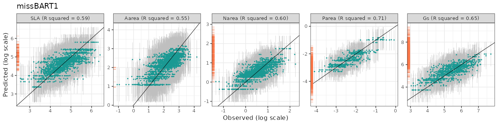
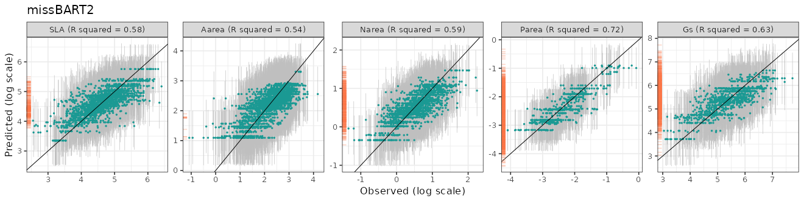
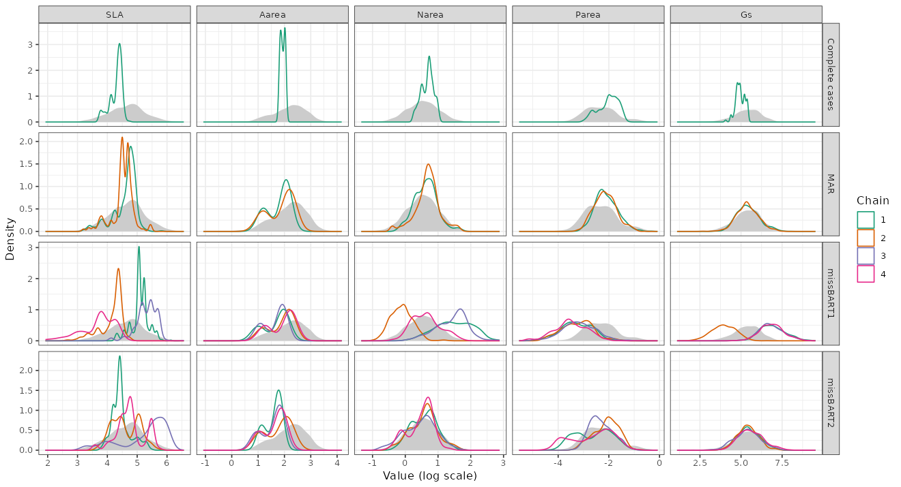
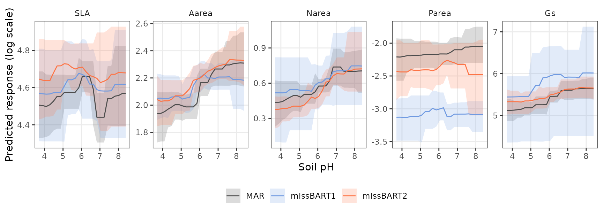
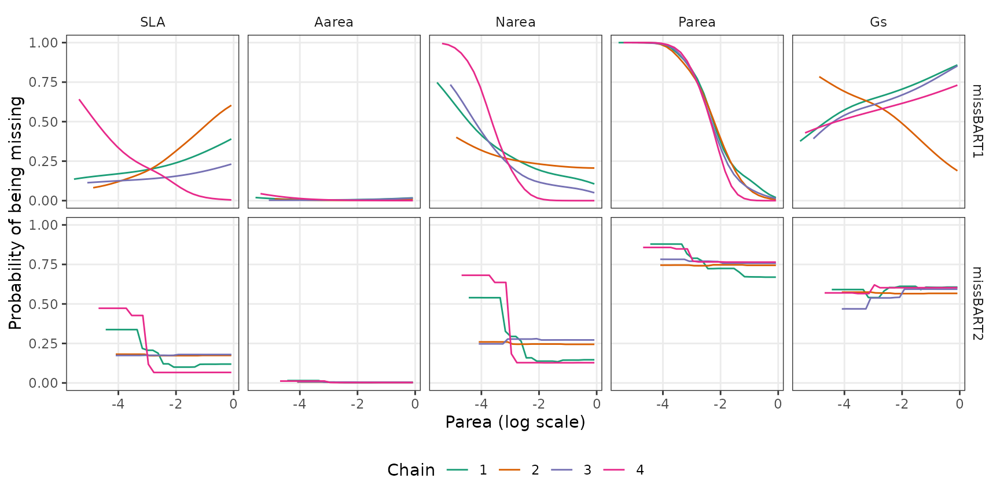
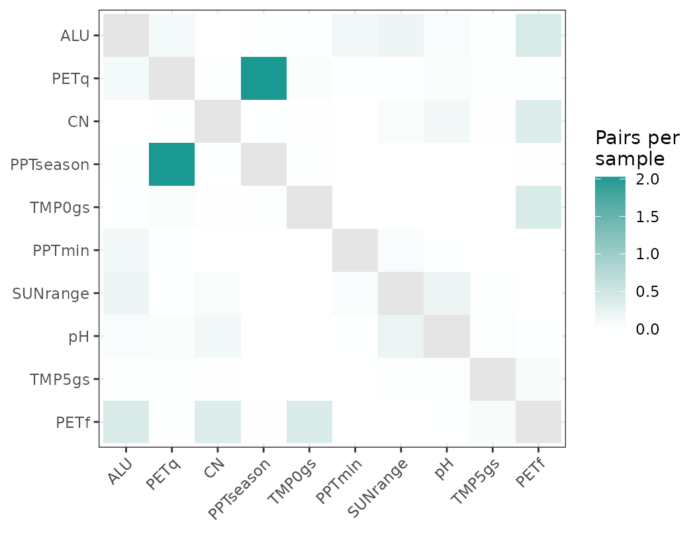

# Real data: leaf photosynthetic traits

This article fits
[`missBART1()`](https://andrewcparnell.github.io/missBART/reference/missBART.md)
and
[`missBART2()`](https://andrewcparnell.github.io/missBART/reference/missBART.md)
to the *global Amax* data of Maire et al. (2015), the application in
Section 7 of Goh, Soh, Parnell and Murphy (2024,
[arXiv:2412.14946](https://arxiv.org/abs/2412.14946)), using version
0.2.0 of the package. It also compares them with the same response model
fitted under the assumption that the missingness can be ignored.

## The data

The data hold five leaf photosynthetic traits for 2368 plants, together
with 46 soil and climate covariates. The traits are specific leaf area
(SLA), light-saturated photosynthetic rate (Aarea), leaf nitrogen
(Narea), leaf phosphorus (Parea) and stomatal conductance (Gs), all
modelled on the log scale. The covariates are complete, but most of the
responses are not, and only 217 plants have all five:

| Response | Missing | Per cent missing |
|:---------|--------:|-----------------:|
| SLA      |     433 |             18.3 |
| Aarea    |      12 |              0.5 |
| Narea    |     652 |             27.5 |
| Parea    |    1836 |             77.5 |
| Gs       |    1353 |             57.1 |

The data are not distributed with the package, so this article shows
posterior summaries that were saved by
[`Examples/rerun_global_amax.R`](https://github.com/yongchengoh/missBART/blob/main/Examples/rerun_global_amax.R).

## Fitting the models

The settings are those of the paper: 5,000 burn-in and 5,000 kept
iterations, 100 regression trees and 50 missingness trees. Each model is
run as four chains from different starting values, and the trees are
kept so that partial dependence curves can be computed afterwards.

``` r
library(missBART)

data <- as.data.frame(readxl::read_excel("Maire_dataset_for_Andrew.xlsx", sheet = "Data"))
y <- as.matrix(log(data[, c("SLA", "Aarea", "Narea", "Parea", "Gs")]))
x <- as.matrix(data[, which(names(data) == "PPTmean"):ncol(data)])

fit1 <- missBART1(x, y, n_trees = 100, burn = 5000, iters = 5000, thin = 1,
                  n_chains = 4, cores = 4, keep_trees = TRUE)
fit2 <- missBART2(x, y, n_reg_trees = 100, n_class_trees = 50, burn = 5000, iters = 5000, thin = 1,
                  n_chains = 4, cores = 4, keep_trees = TRUE)

# the same response model, with the missingness assumed ignorable (MAR)
fit_mar <- missBART1(x, y, n_trees = 100, burn = 5000, iters = 5000, thin = 1,
                     include_y = FALSE, n_chains = 2, cores = 2, keep_trees = TRUE)
```

Four chains of `missBART1` took 1.7 minutes and four chains of
`missBART2` 1.5 minutes, with the chains of each model run in parallel.

## Fit to the observed responses

Each point is one observed response: its observed value is on the
horizontal axis and the posterior mean prediction of the model is on the
vertical axis. The grey vertical bars are the 95% prediction intervals,
so a point is covered when its bar crosses the diagonal line. The orange
rug on the vertical axis shows the posterior means of the imputed values
for the missing responses, which have no observed value to plot them
against. The points fall in horizontal bands because plants measured at
the same site share the same covariates, and so the same prediction.
These plots correspond to Figure 5 of the paper, with the axes swapped
(first chain of each model).



| Response | missBART1 | missBART2 | MAR | Complete cases | Coverage, missBART1 | Coverage, missBART2 | SD of observed |
|:---|---:|---:|---:|---:|---:|---:|---:|
| SLA | 0.39 | 0.39 | 0.39 | 0.68 | 0.95 | 0.95 | 0.62 |
| Aarea | 0.44 | 0.44 | 0.44 | 0.63 | 0.95 | 0.96 | 0.65 |
| Narea | 0.31 | 0.31 | 0.32 | 0.45 | 0.96 | 0.95 | 0.50 |
| Parea | 0.36 | 0.35 | 0.35 | 0.52 | 0.95 | 0.96 | 0.66 |
| Gs | 0.47 | 0.48 | 0.49 | 0.88 | 0.97 | 0.97 | 0.80 |

Root mean squared error for the observed responses, and coverage of the
95% prediction intervals.

The three models that use every row fit the observed responses equally
well, and the prediction intervals have close to their nominal coverage.
The complete case model is fitted to 217 plants only, so most of its
error is out of sample. The observed responses alone therefore cannot
tell the three models apart; they differ in what they say about the
*missing* responses.

## What is imputed

The grey area in each panel is the distribution of the observed values
of a response. The lines are the distributions of the imputed values
(posterior means), one line per chain.



| Model           | Chain |  SLA | Aarea | Narea | Parea |   Gs |
|:----------------|------:|-----:|------:|------:|------:|-----:|
| Observed values |       | 4.64 |  2.17 |  0.53 | -2.31 | 5.38 |
| Complete cases  |       | 4.29 |  1.93 |  0.67 | -2.02 | 4.95 |
| MAR             |     1 | 4.59 |  1.78 |  0.63 | -2.10 | 5.43 |
| MAR             |     2 | 4.51 |  1.86 |  0.68 | -2.14 | 5.40 |
| missBART2       |     1 | 4.47 |  1.58 |  0.58 | -2.61 | 5.47 |
| missBART2       |     2 | 4.61 |  1.75 |  0.57 | -2.10 | 5.40 |
| missBART2       |     3 | 5.23 |  1.55 |  0.46 | -2.30 | 5.38 |
| missBART2       |     4 | 4.76 |  1.62 |  0.47 | -2.65 | 5.61 |
| missBART1       |     1 | 5.09 |  1.65 |  1.48 | -3.29 | 6.92 |
| missBART1       |     2 | 4.15 |  1.87 | -0.11 | -3.24 | 3.94 |
| missBART1       |     3 | 5.31 |  1.64 |  1.42 | -3.18 | 6.85 |
| missBART1       |     4 | 3.70 |  1.91 |  0.64 | -3.50 | 6.88 |

Mean of the observed values, and mean of the imputed values in each
chain.

- Under MAR the imputations are predictions from the covariates and the
  observed responses of the same plant, so they sit inside the observed
  distribution, and the two chains agree closely.
- `missBART2` stays fairly close to MAR, but its chains differ from each
  other more than the MAR chains do.
- `missBART1` imputes values far from the observed ones, and its chains
  disagree about the direction: for most responses some chains impute
  values well *above* the observed ones and others well *below*.

## How stable are the fits?

[`chain_diagnostics()`](https://andrewcparnell.github.io/missBART/reference/chain_diagnostics.md)
compares the chains. The potential scale reduction factor (R-hat) should
be close to 1. The second table gives the same information in more
tangible units: the difference between the largest and smallest chain
mean, in standard deviations of the observed response.

| Model     |  SLA | Aarea | Narea | Parea |    Gs |
|:----------|-----:|------:|------:|------:|------:|
| MAR       | 1.17 |  1.07 |  1.13 |  1.06 |  1.06 |
| missBART2 | 3.86 |  1.20 |  1.29 |  5.30 |  1.95 |
| missBART1 | 5.47 |  1.30 | 10.33 |  2.44 | 24.03 |

R-hat of the mean imputed value of each response.

| Model     |  SLA | Aarea | Narea | Parea |   Gs |
|:----------|-----:|------:|------:|------:|-----:|
| MAR       | 0.13 |  0.11 |  0.11 |  0.07 | 0.04 |
| missBART2 | 1.25 |  0.30 |  0.23 |  0.84 | 0.29 |
| missBART1 | 2.63 |  0.40 |  3.20 |  0.49 | 3.72 |

Range of the mean imputed value across chains, in standard deviations of
the observed response.

The chains of `missBART1` differ by several standard deviations for some
responses. Within a chain the imputations are stable, so each chain has
settled in a different mode and does not move between them in 10,000
iterations. The `missBART2` chains are much closer to each other, but
they have not converged to a common answer either (the R-hat of a mean
over hundreds of imputed values is a strict measure, because that mean
varies very little within a chain).

The same shows in the probit coefficients. The table gives the posterior
mean of the coefficient of each response in the model for its own
missingness. A positive value means that large values are more likely to
be *missing*. The paper used the opposite coding, so the signs of its
values are reversed here to match. The table includes four chains with
the update of the missing responses described in the paper
(`ymis_update = "marginal"`), and four shorter chains with the original
R code of version 0.1.0, which takes about 29 minutes for 1,000
iterations on these data.

| Version | Iterations | Chain | SLA | Aarea | Narea | Parea | Gs |
|:---|---:|---:|---:|---:|---:|---:|---:|
| 0.2.0, conditional update | 10,000 | 1 | 24.7 | -6.1 | 26.8 | -19.5 | 24.2 |
| 0.2.0, conditional update | 10,000 | 2 | -12.4 | 7.2 | -20.8 | -14.8 | -24.7 |
| 0.2.0, conditional update | 10,000 | 3 | 26.1 | -7.5 | 29.4 | -18.3 | 24.0 |
| 0.2.0, conditional update | 10,000 | 4 | -26.8 | -1.3 | 4.8 | -21.7 | 22.8 |
| 0.2.0, marginal update | 10,000 | 1 | 14.7 | 2.5 | 1.3 | -18.0 | -12.9 |
| 0.2.0, marginal update | 10,000 | 2 | 17.6 | 3.1 | 3.6 | -17.3 | 17.1 |
| 0.2.0, marginal update | 10,000 | 3 | 15.2 | 0.9 | 8.1 | -17.4 | -13.5 |
| 0.2.0, marginal update | 10,000 | 4 | 17.2 | 0.1 | -0.1 | -17.4 | -13.0 |
| 0.1.0 (original R code) | 1,000 | 1 | 12.9 | 1.1 | 0.4 | -14.8 | -11.4 |
| 0.1.0 (original R code) | 1,000 | 2 | 10.9 | -3.1 | 8.3 | -10.2 | -10.9 |
| 0.1.0 (original R code) | 1,000 | 3 | 4.6 | 2.3 | -12.5 | -8.5 | -12.4 |
| 0.1.0 (original R code) | 1,000 | 4 | 10.0 | 0.0 | -10.5 | -13.8 | -11.9 |
| Paper (Figure 6, read by eye, sign reversed) | 10,000 |  | 15.0 | 3.0 | -5.0 | -18.0 | -13.0 |

The number of chains, out of four, whose coefficient has the same sign
as in the paper:

| Version                   | SLA | Aarea | Narea | Parea |  Gs |
|:--------------------------|----:|------:|------:|------:|----:|
| 0.2.0, conditional update |   2 |     1 |     1 |     4 |   1 |
| 0.2.0, marginal update    |   4 |     4 |     1 |     4 |   3 |
| 0.1.0 (original R code)   |   4 |     3 |     2 |     4 |   4 |

The chains of every version disagree with each other for at least one
response. Where the original code and the marginal update agree with the
paper more often than the conditional update does, that is not evidence
for the direction reported in the paper, because the conditional update
is the correct full conditional distribution.

So the multimodality is a property of the model on these data, and it is
present in the original code too. Which mode a chain finds depends on
its starting values, and how often each mode is found depends on how the
missing responses are updated. Because the chains do not move between
modes, their relative posterior weights cannot be judged from these
runs.

This is the well-known weak identifiability of selection models. With a
probit *regression* for the missingness, a response that is mostly
missing can be explained almost equally well by missing values that are
all large or all small, and the sampler cannot cross between the two
explanations. The practical consequences are:

- Conclusions about the *direction* of the missingness mechanism from
  `missBART1` on these data (for example, Figure 6 of the paper) depend
  on the chain, and should not be drawn from a single run.
- Several chains should be run and compared (`n_chains`) before
  interpreting the coefficients or imputations of either model.
- `missBART2` is the safer choice here, because its chains differ far
  less, but its imputations should still be reported with their
  between-chain variation.

## Does modelling the missingness change the conclusions?

The partial dependence of each response on soil pH, one of the
covariates highlighted in the paper (its Figure 9), under MAR and under
the two joint models. The lines are posterior means and the bands 95%
intervals, pooled over chains.



The curves average over all plants, including those whose response is
missing, and the models disagree about those. Measured in standard
deviations of the observed response, the average shift of each curve
relative to MAR is:

| Model     |  SLA | Aarea | Narea | Parea |   Gs |
|:----------|-----:|------:|------:|------:|-----:|
| missBART1 | 0.09 |  0.02 |  0.07 | -1.43 | 0.48 |
| missBART2 | 0.20 |  0.10 | -0.09 | -0.39 | 0.12 |

The covariates used by the regression trees are broadly similar across
the models. The rank correlation of the variable importances with those
under MAR is 0.34 for `missBART1` and 0.58 for `missBART2`, and 3 and 5
of the ten most important covariates are shared.

## Missingness probabilities

The partial dependence of the probability that each response is missing
on the value of Parea, as in Figure 10 of the paper (which showed the
probability of being observed). One line per chain.



For `missBART1`, the curve for the missingness of Parea itself is steep
and the same in every chain: plants with low Parea are much more likely
to have it missing. The curves for the other responses differ between
chains, in line with the coefficients above. The `missBART2` curves are
flatter and show the same direction for Parea in the chains where there
is any effect.

## Variable importance and interactions from missBART2

The ten predictors used most often in the missingness trees and in the
regression trees (averaged over chains), as in Figure 7 of the paper.


The importance is the proportion of splitting rules that use a
predictor, averaged over the posterior samples. It is spread thinly over
many correlated covariates, so the ordering varies from chain to chain.
Across the four chains, the three most used predictors in the
missingness trees are: ALU, Parea, CLAY; ALU, TMPmean, SBA; ALU, SAND,
BULK; ALU, PPTseason, Miq. Exchangeable aluminium (ALU), which the paper
found to be the most important predictor of the missingness, ranks 1, 1,
1, 1 out of 51. Parea, the only response among the top ten in the paper,
ranks 2, 42, 18, 9. A response can also be used in the missingness trees
simply because it is correlated with the covariates, so its importance
is not by itself evidence that the data are missing not at random.

[`interactions()`](https://andrewcparnell.github.io/missBART/reference/interactions.md)
counts how often two predictors are used in consecutive splitting rules
on the same branch, as in Figure 8 of the paper. For the ten most
important predictors of the regression trees (first chain):



## Reference

Maire, V. et al. (2015). Global effects of soil and climate on leaf
photosynthetic traits and rates. *Global Ecology and Biogeography*,
24(6), 706-717.
