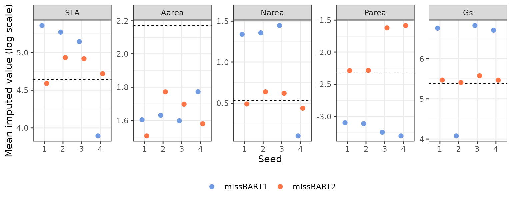

# Real data: leaf photosynthetic traits

This article fits [`missBART1()`](../reference/missBART.md) and
[`missBART2()`](../reference/missBART.md) to the *global Amax* data of
Maire et al. (2015), the application in Section 7 of Goh, Soh, Parnell
and Murphy (2024, [arXiv:2412.14946](https://arxiv.org/abs/2412.14946)),
using version 0.2.0 of the package.

## The data

The data hold five leaf photosynthetic traits for 2368 plants, together
with 46 soil and climate covariates. The traits are specific leaf area
(SLA), light-saturated photosynthetic rate (Aarea), leaf nitrogen
(Narea), leaf phosphorus (Parea) and stomatal conductance (Gs), all
modelled on the log scale. The covariates are complete, but most of the
responses are not:

| Response | Missing | Per cent missing |
|:---------|--------:|-----------------:|
| SLA      |     433 |             18.3 |
| Aarea    |      12 |              0.5 |
| Narea    |     652 |             27.5 |
| Parea    |    1836 |             77.5 |
| Gs       |    1353 |             57.1 |

The data are not distributed with the package, so this article shows
posterior summaries that were saved by
[`Examples/rerun_global_amax.R`](https://github.com/yongchengoh/missBART/blob/main/Examples/rerun_global_amax.R).

## Fitting the models

The settings are those of the paper: 5,000 burn-in and 5,000 kept
iterations, 100 regression trees and 50 missingness trees.

``` r
library(missBART)

data <- as.data.frame(readxl::read_excel("Maire_dataset_for_Andrew.xlsx", sheet = "Data"))
y <- as.matrix(log(data[, c("SLA", "Aarea", "Narea", "Parea", "Gs")]))
x <- as.matrix(data[, which(names(data) == "PPTmean"):ncol(data)])

set.seed(1)
fit1 <- missBART1(x, y, n_trees = 100, burn = 5000, iters = 5000, thin = 1)
fit2 <- missBART2(x, y, n_reg_trees = 100, n_class_trees = 50, burn = 5000, iters = 5000, thin = 1)
```

Each fit took about 1.4 minutes (with eight fits running at the same
time).

## Fit to the observed responses

Posterior mean predictions against the observed values, with 95%
prediction intervals. The rug on the vertical axis shows the posterior
means of the imputed values. These correspond to Figure 5 of the paper.


| Response | RMSE, missBART1 | RMSE, missBART2 | Coverage, missBART1 | Coverage, missBART2 | SD of observed |
|:---|---:|---:|---:|---:|---:|
| SLA | 0.40 | 0.40 | 0.95 | 0.95 | 0.62 |
| Aarea | 0.44 | 0.44 | 0.96 | 0.95 | 0.65 |
| Narea | 0.32 | 0.32 | 0.96 | 0.95 | 0.50 |
| Parea | 0.36 | 0.36 | 0.95 | 0.96 | 0.66 |
| Gs | 0.49 | 0.49 | 0.97 | 0.98 | 0.80 |

In-sample root mean squared error and coverage of the 95% prediction
intervals for the observed responses (first seed).

Both models fit the observed responses equally well, and the prediction
intervals have close to their nominal coverage. As the paper notes, the
two models differ in what they impute: `missBART2` imputes values within
the range of the observed data, while `missBART1` imputes values that
are far from the observed ones.

## How stable are the imputations?

Each model was run from four different seeds. The plot shows the average
imputed value of each response for each seed, next to the average of the
observed values (dashed line).



The `missBART2` imputations stay close to the observed values and are
broadly similar across seeds (Parea, with 78% missing, varies the most).
The `missBART1` imputations are not: for SLA, Narea and Gs, one seed
imputes values well *above* the observed ones where the other seeds
impute values well *below*, or the other way around. Within a chain the
imputations are stable (the two halves of each chain agree), so each
chain has settled in a different mode and does not move between them in
10,000 iterations.

The same shows in the probit coefficients. The table gives the posterior
mean of the coefficient of each response in the model for its own
missingness (a positive value means that large values are more likely to
be observed). It includes four chains with the update of the missing
responses used in the paper (`ymis_update = "marginal"`), and four
shorter chains with the original R code of version 0.1.0, which takes
about 29 minutes for 1,000 iterations on these data.

| Version | Iterations | Seed | SLA | Aarea | Narea | Parea | Gs |
|:---|---:|---:|---:|---:|---:|---:|---:|
| 0.2.0, conditional update (default) | 10,000 | 1 | -23.4 | 7.6 | -23.8 | 17.1 | -23.3 |
| 0.2.0, conditional update (default) | 10,000 | 2 | -26.4 | 1.7 | -33.1 | 19.5 | 19.9 |
| 0.2.0, conditional update (default) | 10,000 | 3 | -23.7 | 10.2 | -25.1 | 19.2 | -23.7 |
| 0.2.0, conditional update (default) | 10,000 | 4 | 21.6 | 0.3 | 17.4 | 18.7 | -25.4 |
| 0.2.0, marginal update | 10,000 | 1 | -6.2 | -0.7 | -11.3 | 12.1 | 12.7 |
| 0.2.0, marginal update | 10,000 | 2 | -8.9 | 2.1 | -10.0 | -14.2 | 11.6 |
| 0.2.0, marginal update | 10,000 | 3 | -21.0 | -3.0 | -1.4 | 17.2 | -16.6 |
| 0.2.0, marginal update | 10,000 | 4 | -11.0 | -0.8 | -4.7 | 18.2 | 11.8 |
| 0.1.0 (original R code) | 1,000 | 1 | -12.9 | -1.1 | -0.4 | 14.8 | 11.4 |
| 0.1.0 (original R code) | 1,000 | 2 | -10.9 | 3.1 | -8.3 | 10.2 | 10.9 |
| 0.1.0 (original R code) | 1,000 | 3 | -4.6 | -2.3 | 12.5 | 8.5 | 12.4 |
| 0.1.0 (original R code) | 1,000 | 4 | -10.0 | 0.0 | 10.5 | 13.8 | 11.9 |
| Paper (Figure 6, read by eye) | 10,000 |  | -15.0 | -3.0 | 5.0 | 18.0 | 13.0 |

Reading down the columns:

- **SLA** and **Parea** are consistent. In 11 of the 12 chains large
  values of SLA are more likely to be missing, and in 11 of 12 large
  values of Parea are more likely to be observed, as reported in the
  paper.
- **Narea** is not. The sign differs between chains of the original
  code, and most chains of the new code have the opposite sign to the
  paper.
- **Gs** depends on the update. The original code and the marginal
  update mostly agree with the paper (large values more likely to be
  observed), while three of the four chains with the conditional update
  settle on the opposite explanation.
- Aarea has only 12 missing values, so its coefficient is poorly
  determined.

So the multimodality is a property of the model on these data, and it is
present in the original code too. Which mode a chain finds depends on
the seed, and how often each mode is found depends on how the missing
responses are updated. Because the chains do not move between modes,
their relative posterior weights cannot be judged from these runs.

This is the well-known weak identifiability of selection models. With a
probit *regression* for the missingness, a response that is mostly
missing can be explained almost equally well by missing values that are
all large or all small, and the sampler cannot cross between the two
explanations. The practical consequences are:

- Conclusions about the *direction* of the missingness mechanism from
  `missBART1` on these data (for example, Figure 6 of the paper) are
  reliable for SLA and Parea, but depend on the chain for Narea and Gs.
- Several chains from different starting values should be run and
  compared before interpreting `missBART1` coefficients or imputations.
- `missBART2` is the safer choice here.

## Variable importance from missBART2

The ten predictors used most often in the missingness trees and in the
regression trees (first seed), as in Figure 7 of the paper.


As in the paper, exchangeable aluminium (ALU) is among the most
important predictors of the missingness and Parea is the response used
most often in the missingness trees. Across the four seeds Parea ranks
3, 2, 10, 3 out of 51 predictors, and the three most used predictors
are: ALU, SILT, Parea; ALU, Parea, SILT; ALU, SAND, SUNmean; ALU, CLAY,
Parea. The importances are spread thinly over many correlated
covariates, so the exact ordering varies from seed to seed.

## Reference

Maire, V. et al. (2015). Global effects of soil and climate on leaf
photosynthetic traits and rates. *Global Ecology and Biogeography*,
24(6), 706-717.
