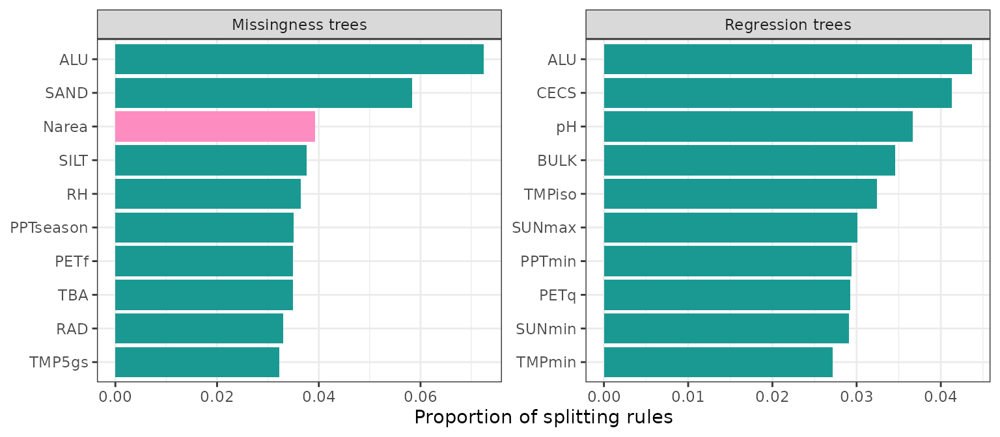

# Real data: leaf photosynthetic traits

This article fits
[`missBART1()`](https://andrewcparnell.github.io/missBART/reference/missBART.md)
and
[`missBART2()`](https://andrewcparnell.github.io/missBART/reference/missBART.md)
to the *global Amax* data of Maire et al. (2015), the application in
Section 7 of Goh, Soh, Parnell and Murphy (2024,
[arXiv:2412.14946](https://arxiv.org/abs/2412.14946)), using version
0.2.0 of the package.

## The data

The data hold five leaf photosynthetic traits for 2368 plants, together
with 46 soil and climate covariates. The traits are specific leaf area
(SLA), light-saturated photosynthetic rate (Aarea), leaf nitrogen
(Narea), leaf phosphorus (Parea) and stomatal conductance (Gs), all
modelled on the log scale. The covariates are complete, but most of the
responses are not:

| Response | Missing | Per cent missing |
|:---------|--------:|-----------------:|
| SLA      |     433 |             18.3 |
| Aarea    |      12 |              0.5 |
| Narea    |     652 |             27.5 |
| Parea    |    1836 |             77.5 |
| Gs       |    1353 |             57.1 |

The data are not distributed with the package, so this article shows
posterior summaries that were saved by
[`Examples/rerun_global_amax.R`](https://github.com/yongchengoh/missBART/blob/main/Examples/rerun_global_amax.R).

## Fitting the models

The settings are those of the paper: 5,000 burn-in and 5,000 kept
iterations, 100 regression trees and 50 missingness trees.

``` r
library(missBART)

data <- as.data.frame(readxl::read_excel("Maire_dataset_for_Andrew.xlsx", sheet = "Data"))
y <- as.matrix(log(data[, c("SLA", "Aarea", "Narea", "Parea", "Gs")]))
x <- as.matrix(data[, which(names(data) == "PPTmean"):ncol(data)])

set.seed(1)
fit1 <- missBART1(x, y, n_trees = 100, burn = 5000, iters = 5000, thin = 1)
fit2 <- missBART2(x, y, n_reg_trees = 100, n_class_trees = 50, burn = 5000, iters = 5000, thin = 1)
```

Each fit took about 1.3 minutes (with twelve fits running at the same
time).

## Fit to the observed responses

Each point is one observed response: its observed value is on the
horizontal axis and the posterior mean prediction of the model is on the
vertical axis. The grey vertical bars are the 95% prediction intervals,
so a point is covered when its bar crosses the diagonal line. The orange
rug on the vertical axis shows the posterior means of the imputed values
for the missing responses, which have no observed value to plot them
against. The points fall in horizontal bands because plants measured at
the same site share the same covariates, and so the same prediction.
These plots correspond to Figure 5 of the paper, with the axes swapped.


| Response | RMSE, missBART1 | RMSE, missBART2 | Coverage, missBART1 | Coverage, missBART2 | SD of observed |
|:---|---:|---:|---:|---:|---:|
| SLA | 0.39 | 0.40 | 0.95 | 0.95 | 0.62 |
| Aarea | 0.44 | 0.44 | 0.96 | 0.96 | 0.65 |
| Narea | 0.32 | 0.32 | 0.96 | 0.96 | 0.50 |
| Parea | 0.36 | 0.35 | 0.97 | 0.97 | 0.66 |
| Gs | 0.50 | 0.49 | 0.97 | 0.97 | 0.80 |

In-sample root mean squared error and coverage of the 95% prediction
intervals for the observed responses (first seed).

Both models fit the observed responses equally well, and the prediction
intervals have close to their nominal coverage. As the paper notes, the
two models differ in what they impute: `missBART2` imputes values within
the range of the observed data, while `missBART1` imputes values that
are far from the observed ones.

## How stable are the imputations?

Each model was run from four different seeds. The plot shows the average
imputed value of each response for each seed, next to the average of the
observed values (dashed line).


The `missBART2` imputations stay fairly close to the observed values,
although they are not identical across seeds. The `missBART1`
imputations are very different across seeds: for every response except
Aarea (which has only 12 missing values), some seeds impute values well
*above* the observed ones and other seeds values well *below*. Within a
chain the imputations are stable (the two halves of each chain agree),
so each chain has settled in a different mode and does not move between
them in 10,000 iterations.

The same shows in the probit coefficients. The table gives the posterior
mean of the coefficient of each response in the model for its own
missingness. A positive value means that large values are more likely to
be *missing*. The paper used the opposite coding, so the signs of its
values are reversed here to match. The table includes four chains with
the update of the missing responses described in the paper
(`ymis_update = "marginal"`), and four shorter chains with the original
R code of version 0.1.0, which takes about 29 minutes for 1,000
iterations on these data.

| Version | Iterations | Seed | SLA | Aarea | Narea | Parea | Gs |
|:---|---:|---:|---:|---:|---:|---:|---:|
| 0.2.0, conditional update | 10,000 | 1 | -20.9 | 6.3 | -24.5 | 14.3 | -21.9 |
| 0.2.0, conditional update | 10,000 | 2 | -20.6 | 3.4 | -26.4 | 17.5 | -22.3 |
| 0.2.0, conditional update | 10,000 | 3 | 24.2 | -9.2 | 27.3 | -19.5 | 23.1 |
| 0.2.0, conditional update | 10,000 | 4 | 26.6 | 0.9 | 34.2 | -19.2 | -21.0 |
| 0.2.0, marginal update | 10,000 | 1 | 19.3 | 1.6 | -0.2 | -18.1 | 16.7 |
| 0.2.0, marginal update | 10,000 | 2 | 9.4 | -1.1 | 4.2 | 12.9 | -13.1 |
| 0.2.0, marginal update | 10,000 | 3 | 18.1 | 0.3 | -0.5 | -18.4 | -12.9 |
| 0.2.0, marginal update | 10,000 | 4 | 13.6 | 2.7 | 6.3 | -17.6 | -12.6 |
| 0.1.0 (original R code) | 1,000 | 1 | 12.9 | 1.1 | 0.4 | -14.8 | -11.4 |
| 0.1.0 (original R code) | 1,000 | 2 | 10.9 | -3.1 | 8.3 | -10.2 | -10.9 |
| 0.1.0 (original R code) | 1,000 | 3 | 4.6 | 2.3 | -12.5 | -8.5 | -12.4 |
| 0.1.0 (original R code) | 1,000 | 4 | 10.0 | 0.0 | -10.5 | -13.8 | -11.9 |
| Paper (Figure 6, read by eye, sign reversed) | 10,000 |  | 15.0 | 3.0 | -5.0 | -18.0 | -13.0 |

The number of chains, out of four, whose coefficient has the same sign
as in the paper:

| Version                   | SLA | Aarea | Narea | Parea |  Gs |
|:--------------------------|----:|------:|------:|------:|----:|
| 0.2.0, conditional update |   2 |     3 |     2 |     2 |   3 |
| 0.2.0, marginal update    |   4 |     3 |     2 |     3 |   3 |
| 0.1.0 (original R code)   |   4 |     3 |     2 |     4 |   4 |

With the original code, and with the marginal update, most chains agree
with the paper about SLA, Parea and Gs: large values of SLA are more
likely to be missing, and large values of Parea and Gs are more likely
to be observed. Narea is not settled even there. With the conditional
update, which is the correct full conditional distribution, three of the
four chains fall into two explanations that are mirror images of each
other (every sign reversed), and no direction is settled for any
response.

So the multimodality is a property of the model on these data, and it is
present in the original code too. Which mode a chain finds depends on
the seed, and how often each mode is found depends on how the missing
responses are updated. Because the chains do not move between modes,
their relative posterior weights cannot be judged from these runs.

This is the well-known weak identifiability of selection models. With a
probit *regression* for the missingness, a response that is mostly
missing can be explained almost equally well by missing values that are
all large or all small, and the sampler cannot cross between the two
explanations. The practical consequences are:

- Conclusions about the *direction* of the missingness mechanism from
  `missBART1` on these data (for example, Figure 6 of the paper) depend
  on the chain, and should not be drawn from a single run.
- Several chains from different starting values should be run and
  compared before interpreting `missBART1` coefficients or imputations.
- `missBART2` is the safer choice here.

## Variable importance from missBART2

The ten predictors used most often in the missingness trees and in the
regression trees (first seed), as in Figure 7 of the paper.



The importances are spread thinly over many correlated covariates, so
the ordering varies from seed to seed. Across the four seeds, the three
most used predictors in the missingness trees are: ALU, SAND, Narea;
SILT, ALU, PPTmin; SAND, Parea, ALU; ALU, Narea, TMP0gs. Exchangeable
aluminium (ALU), which the paper also found to be the most important
predictor of the missingness, ranks 1, 2, 3, 1 out of 51. Parea, the
only response among the top ten in the paper, ranks 47, 27, 2, 20, so
the importance of individual responses in the missingness trees is not
stable either.

## Reference

Maire, V. et al. (2015). Global effects of soil and climate on leaf
photosynthetic traits and rates. *Global Ecology and Biogeography*,
24(6), 706-717.
