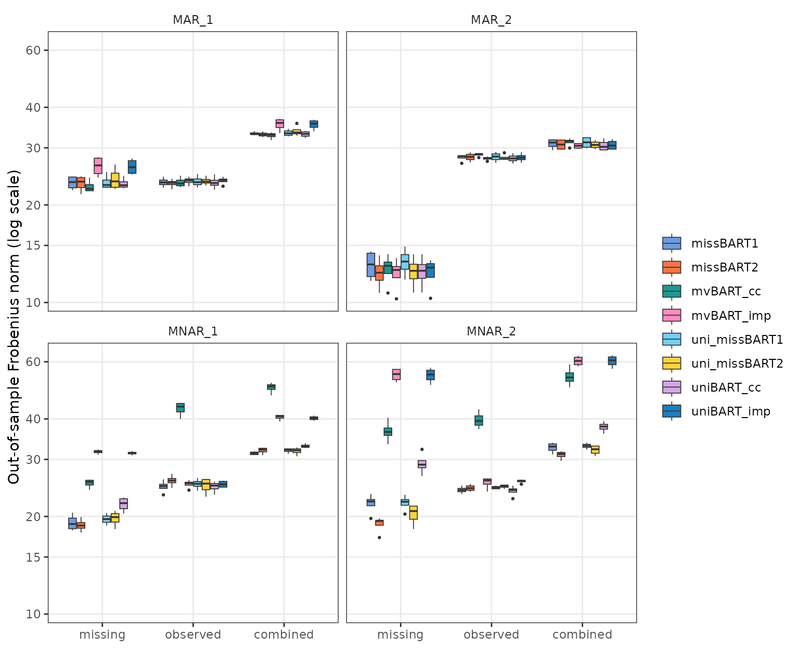
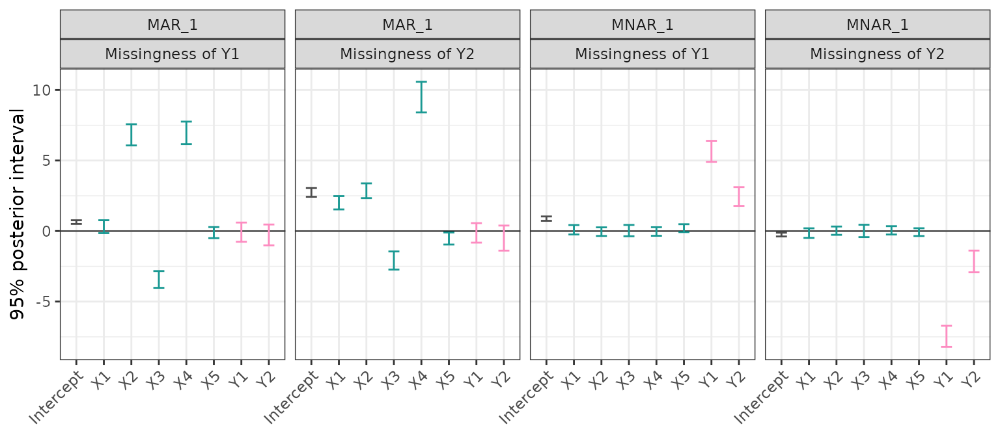
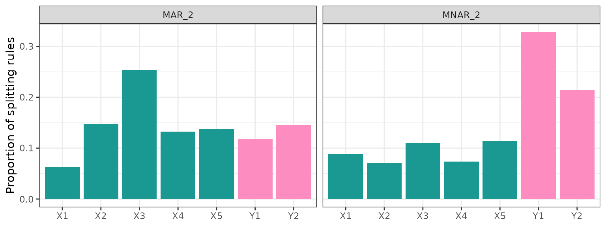
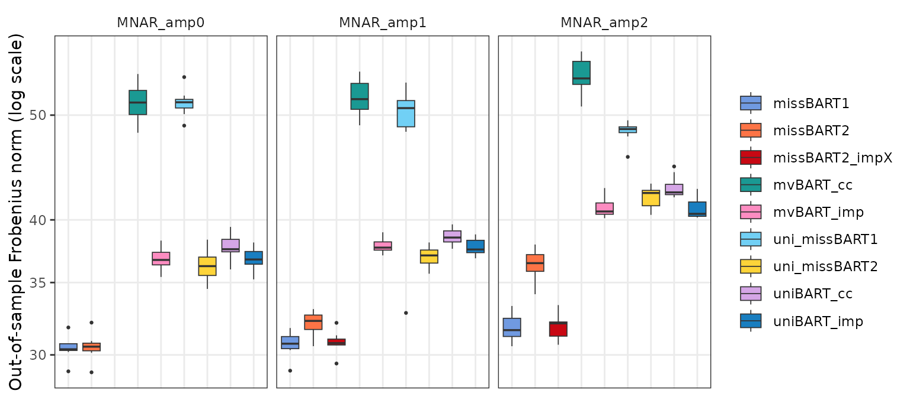

# Simulation checking

The samplers in **missBART** were rewritten in C++ for version 0.2.0,
and several steps were corrected or changed along the way (see the
[changelog](https://andrewcparnell.github.io/missBART/news/index.md)):
among others, the update of the missing responses, a proposal ratio in
the tree updates, and the standardisation of the responses. This article
re-runs the simulation studies of Goh, Soh, Parnell and Murphy (2024,
[arXiv:2412.14946](https://arxiv.org/abs/2412.14946)) with the new code
and compares the results with those reported in the paper.

## What was run

The simulated data sets, the cross-validation folds and the missForest
imputations used in the paper are stored in the
[`Examples/`](https://github.com/yongchengoh/missBART/tree/main/Examples)
folder of the repository, so the comparison uses exactly the same data
and folds. The settings follow the paper: 5,000 burn-in and 5,000 kept
iterations, 100 regression trees, and 20 (bivariate and univariate
examples) or 50 (five-response examples) missingness trees.

| Scenarios                       | Paper       | Responses | Folds |
|---------------------------------|-------------|-----------|-------|
| MAR 1, MAR 2, MNAR 1, MNAR 2    | Section 6.1 | 2         | 4     |
| MNAR_amp0, MNAR_amp1, MNAR_amp2 | Section 6.2 | 5         | 8     |
| u-shape, n-shape                | Appendix D  | 1         | 4     |

Each model is fitted to the training folds and predicts the held-out
fold. As in the paper, accuracy is the Frobenius norm of the difference
between the predictions and the true simulated responses in the held-out
fold, computed over the cells that were missing, the cells that were
observed, and all cells.

The code is in
[`Examples/rerun_paper_simulations.R`](https://github.com/yongchengoh/missBART/blob/main/Examples/rerun_paper_simulations.R).
This article only reads the predictions that script saved.

408 model fits were run (0 failed), taking 7.1 hours of computing time
in total, or about 7 minutes on 60 cores.

## Bivariate examples (Figure 1 of the paper)

All four panels share one logarithmic axis. The means and standard
deviations over the four folds are:

| cells | scenario | missBART1 | missBART2 | mvBART_cc | mvBART_imp | uni_missBART1 | uni_missBART2 | uniBART_cc | uniBART_imp |
|:---|:---|:---|:---|:---|:---|:---|:---|:---|:---|
| missing | MAR_1 | 23.4 (1.1) | 23.3 (1.3) | 22.8 (1.0) | 26.3 (1.9) | 23.5 (1.2) | 24.1 (1.9) | 23.3 (0.9) | 26.2 (1.5) |
| observed | MAR_1 | 23.5 (0.8) | 23.3 (0.7) | 23.5 (0.8) | 23.7 (0.7) | 23.6 (1.0) | 23.7 (0.7) | 23.5 (1.1) | 23.8 (0.7) |
| combined | MAR_1 | 33.2 (0.4) | 33.0 (0.6) | 32.7 (0.8) | 35.5 (1.6) | 33.4 (0.8) | 33.8 (1.3) | 33.1 (0.7) | 35.4 (1.3) |
| missing | MAR_2 | 13.1 (1.4) | 12.4 (1.4) | 12.7 (1.4) | 12.3 (1.4) | 13.4 (1.3) | 12.5 (1.4) | 12.5 (1.4) | 12.4 (1.4) |
| observed | MAR_2 | 28.0 (0.7) | 28.1 (0.9) | 28.5 (0.4) | 27.8 (0.4) | 28.1 (1.0) | 28.0 (0.6) | 27.8 (0.9) | 28.0 (0.9) |
| combined | MAR_2 | 30.9 (1.1) | 30.7 (1.2) | 31.3 (0.9) | 30.4 (0.6) | 31.2 (1.3) | 30.7 (0.9) | 30.5 (1.2) | 30.6 (1.1) |
| missing | MNAR_1 | 19.2 (1.1) | 18.8 (0.9) | 25.3 (0.8) | 31.7 (0.5) | 19.6 (0.8) | 19.7 (1.1) | 21.8 (1.1) | 31.4 (0.4) |
| observed | MNAR_1 | 24.7 (1.1) | 25.8 (1.1) | 43.0 (2.2) | 25.2 (0.7) | 25.2 (1.0) | 24.9 (1.5) | 24.7 (1.0) | 25.2 (0.6) |
| combined | MNAR_1 | 31.3 (0.4) | 31.9 (0.7) | 49.9 (1.9) | 40.4 (0.8) | 32.0 (0.5) | 31.8 (0.8) | 33.0 (0.5) | 40.2 (0.6) |
| missing | MNAR_2 | 21.9 (1.6) | 18.9 (1.1) | 36.7 (2.8) | 54.7 (2.6) | 22.0 (1.2) | 20.4 (1.5) | 29.2 (2.3) | 54.5 (2.9) |
| observed | MNAR_2 | 24.2 (0.6) | 24.5 (0.6) | 39.7 (2.4) | 25.4 (1.1) | 24.6 (0.3) | 24.8 (0.3) | 24.0 (0.9) | 25.7 (0.4) |
| combined | MNAR_2 | 32.6 (1.2) | 30.9 (0.9) | 54.1 (3.7) | 60.4 (2.1) | 33.0 (0.7) | 32.1 (1.1) | 37.8 (1.4) | 60.3 (2.6) |

The table compares the median over folds with the value read off Figure
1 of the paper. The paper only reports these results as box plots, so
the paper values were read by eye and are accurate to about half a unit.
A dash means the paper omitted the result because it was off the scale.

| scenario | cells | source | missBART1 | missBART2 | mvBART_cc | mvBART_imp | uni_missBART1 | uni_missBART2 | uniBART_cc | uniBART_imp |
|:---|:---|:---|---:|---:|---:|---:|---:|---:|---:|---:|
| MAR_1 | missing | paper | 23.0 | 23.5 | 23.0 | 25.8 | 23.5 | 24.0 | 23.2 | 26.0 |
|  |  | 0.2.0 | 23.5 | 23.6 | 22.4 | 26.5 | 23.0 | 23.7 | 23.0 | 26.2 |
| MAR_1 | combined | paper | 32.4 | 32.9 | 32.7 | 35.2 | 33.2 | 33.7 | 33.2 | 35.2 |
|  |  | 0.2.0 | 33.1 | 33.0 | 32.9 | 35.8 | 33.3 | 33.4 | 33.1 | 35.6 |
| MAR_2 | missing | paper | 12.7 | 12.2 | 12.8 | 12.3 | 13.0 | 12.5 | 12.3 | 12.4 |
|  |  | 0.2.0 | 13.1 | 12.4 | 13.0 | 12.6 | 13.4 | 12.5 | 12.5 | 12.8 |
| MAR_2 | combined | paper | 30.9 | 30.2 | 31.5 | 30.4 | 30.9 | 30.5 | 30.2 | 30.4 |
|  |  | 0.2.0 | 31.2 | 30.7 | 31.5 | 30.5 | 31.2 | 30.6 | 30.2 | 30.5 |
| MNAR_1 | missing | paper | 19.6 | 18.5 | 25.2 | 31.2 | 21.0 | 19.4 | 22.2 | 31.3 |
|  |  | 0.2.0 | 19.0 | 18.8 | 25.6 | 31.7 | 19.6 | 19.9 | 22.0 | 31.4 |
| MNAR_1 | combined | paper | 31.4 | 32.0 | – | 40.1 | 32.1 | 31.8 | 33.0 | 40.5 |
|  |  | 0.2.0 | 31.3 | 32.2 | 50.4 | 40.7 | 32.1 | 32.0 | 32.9 | 40.2 |
| MNAR_2 | missing | paper | 21.5 | 18.8 | 36.5 | – | 26.0 | 20.6 | 27.0 | – |
|  |  | 0.2.0 | 22.3 | 19.4 | 36.5 | 55.0 | 22.2 | 20.8 | 28.9 | 54.8 |
| MNAR_2 | combined | paper | 32.3 | 31.2 | – | – | 35.4 | 32.3 | 36.0 | – |
|  |  | 0.2.0 | 32.9 | 31.2 | 53.7 | 60.4 | 33.1 | 32.2 | 37.9 | 60.6 |

The new code reproduces the paper’s results, and with them its
conclusions:

- Under MAR, all methods perform about the same, apart from the two that
  train on missForest imputations in MAR 1.
- Under MNAR, the joint models give much better predictions for the
  missing responses than the complete-case and imputation-based
  alternatives.
- `missBART2` is the better of the two joint models when the missingness
  was generated from trees (MAR 2, MNAR 2).

The largest difference is `uni_missBART1` in MNAR 2, which does better
here (22.2 against about 26 for the missing responses).

## Recovering the missingness mechanism (Figures 2 and 3)

The probit coefficients of `missBART1`, from the first fold. Each panel
is the missingness of one response. As in Figure 2 of the paper, the
intervals for the coefficients of the responses (`Y1`, `Y2`) cover zero
when the data are MAR and are far from zero when they are MNAR. The
package now codes a missing response as 1, so a positive coefficient
means “more likely to be missing” and all signs are the opposite of
those in the paper’s figure.

Apart from the sign, the numbers agree closely with the paper. In MAR 1
the coefficients of `X2` and `X4` for the first response are -6.7 and
-6.9 (about 7 in the paper), and in MNAR 1 the coefficients of `Y1` are
-5.6 and 7.4 (about 5.6 and -7.5 in the paper).

The variable importance in the missingness trees of `missBART2`, from
the first fold. As in Figure 3 of the paper, the covariates (`X3` in
particular) are used most under MAR 2, and the two responses dominate
under MNAR 2.

## Five responses with missing covariates (Figure 4)

Means and standard deviations over the eight folds:

| cells | scenario | missBART1 | missBART2 | mvBART_cc | mvBART_imp | uni_missBART1 | uni_missBART2 | uniBART_cc | uniBART_imp | missBART2_impX |
|:---|:---|:---|:---|:---|:---|:---|:---|:---|:---|:---|
| combined | MNAR_amp0 | 30.4 (0.8) | 30.5 (0.9) | 51.4 (2.1) | 36.9 (1.0) | 51.3 (1.5) | 36.3 (1.2) | 37.8 (1.1) | 36.8 (1.0) | – |
| combined | MNAR_amp1 | 30.7 (0.8) | 32.1 (0.8) | 51.9 (2.0) | 37.9 (0.7) | 48.6 (6.6) | 37.0 (0.8) | 38.6 (0.7) | 37.7 (0.7) | 30.8 (0.7) |
| combined | MNAR_amp2 | 31.8 (1.0) | 36.4 (1.2) | 54.4 (2.1) | 41.1 (1.0) | 48.3 (1.1) | 42.0 (1.0) | 42.9 (1.1) | 41.0 (1.0) | 31.9 (0.9) |

| scenario | cells | source | missBART1 | missBART2 | missBART2_impX | mvBART_cc | mvBART_imp | uni_missBART1 | uni_missBART2 | uniBART_cc | uniBART_imp |
|:---|:---|:---|---:|---:|---:|---:|---:|---:|---:|---:|---:|
| MNAR_amp0 | combined | paper | 30.5 | 30.5 | – | 52.0 | 37.0 | 49.0 | 36.5 | 38.0 | 37.0 |
|  |  | 0.2.0 | 30.4 | 30.5 | – | 51.4 | 36.7 | 51.4 | 36.2 | 37.6 | 36.8 |
| MNAR_amp1 | combined | paper | 31.0 | 31.8 | 30.8 | 52.0 | 38.0 | 48.0 | 37.0 | 38.5 | 37.8 |
|  |  | 0.2.0 | 30.7 | 32.3 | 30.8 | 51.7 | 37.7 | 50.8 | 37.1 | 38.5 | 37.6 |
| MNAR_amp2 | combined | paper | 33.5 | 36.5 | 31.5 | 54.5 | 41.0 | 43.0 | 42.0 | 42.5 | 41.0 |
|  |  | 0.2.0 | 31.6 | 36.5 | 32.1 | 54.1 | 40.7 | 48.5 | 42.4 | 42.4 | 40.5 |

Again the agreement is close: the joint multivariate models are clearly
best, and covariate imputation helps `missBART2` when many covariates
are missing (MNAR_amp2). `missBART1` does a little better than in the
paper in MNAR_amp2, and `uni_missBART1` a little worse.

### Missingness model or handling of missing covariates?

Three of the models differ in only one respect at a time, which
separates two questions. `missBART1` and `missBART2_impX` both use
covariates imputed beforehand and differ only in the missingness model
(probit regression or probit BART). `missBART2_impX` and `missBART2`
share the missingness model and differ only in how missing covariates
are handled (imputed beforehand, or handled inside the trees).

| scenario | missBART1 (imputed X) | missBART2 (imputed X) | missBART2 (missing X in trees) |
|:---|---:|---:|---:|
| MNAR_amp1 | 30.7 | 30.8 | 32.1 |
| MNAR_amp2 | 31.8 | 31.9 | 36.4 |

In these scenarios, where the missingness was generated from a probit
regression, the choice of missingness model makes little difference, and
imputing the covariates first does better than handling them inside the
trees, clearly so when many covariates are missing (MNAR_amp2).

## Univariate examples (Appendix D)

Out-of-sample root mean squared error over all held-out observations,
averaged over the four folds. For the u-shaped example, the results of
the original R code were saved with the data, so they can be compared
directly. For the n-shaped example the paper values were read off Figure
D.3 (at $`p_t = 1`$).

| model | u-shape, original code | u-shape, 0.2.0 | n-shape, paper | n-shape, 0.2.0 |
|:---|---:|---:|---:|---:|
| missBART1 | 1.18 | 1.20 | 1.32 | 1.40 |
| missBART2 | 1.16 | 1.16 | 1.16 | 1.15 |
| uniBART_cc | 1.15 | 1.18 | 1.31 | 1.28 |
| uniBART_imp | 1.63 | 1.62 | – | 2.45 |

The conclusions are unchanged: all three sensible methods do equally
well for u-shaped missingness, and only `missBART2` copes with n-shaped
missingness, which a probit regression cannot represent.

## The update of the missing responses

Version 0.2.0 changed how `missBART1` updates missing responses in rows
that are only partly missing: by default it now conditions on the
observed responses in the same row (`ymis_update = "conditional"`),
where Appendix C.1 of the paper uses the margin of the full-row
distribution (`ymis_update = "marginal"`). Both were run here.

| scenario | missing: conditional | missing: marginal | combined: conditional | combined: marginal |
|:---|---:|---:|---:|---:|
| MAR_1 | 23.5 | 23.4 | 33.1 | 32.9 |
| MAR_2 | 13.1 | 13.5 | 31.2 | 30.6 |
| MNAR_1 | 19.0 | 18.9 | 31.3 | 31.6 |
| MNAR_2 | 22.3 | 25.6 | 32.9 | 35.5 |
| MNAR_amp0 | 21.6 | 21.6 | 30.4 | 30.4 |
| MNAR_amp1 | 22.0 | 21.9 | 30.7 | 30.5 |
| MNAR_amp2 | 23.9 | 23.7 | 31.6 | 31.7 |

On these data sets the two versions give almost the same predictions,
except in MNAR 2 where the conditional update is clearly better. The
difference matters more when the residual correlation between the
responses is strong: in a separate experiment with three responses and
residual correlations of 0.8, the conditional update reduced the error
of the imputations by about a quarter and recovered the residual
correlation much better (0.68 against 0.28).

## Computing time

Median seconds per fit (10,000 iterations, 1,500 or 1,750 training
rows). The `uni_` models fit one model per response, so their times are
the sum over responses.

| model          | One response | Two responses | Five responses |
|:---------------|-------------:|--------------:|---------------:|
| missBART1      |           23 |            31 |             71 |
| missBART2      |           25 |            31 |             80 |
| missBART2_impX |            – |             – |             82 |
| mvBART_cc      |            – |            12 |              7 |
| mvBART_imp     |            – |            24 |             43 |
| uni_missBART1  |            – |            48 |            144 |
| uni_missBART2  |            – |            52 |            199 |
| uniBART_cc     |           13 |            29 |             51 |
| uniBART_imp    |           22 |            44 |            112 |

The fits ran 60 at a time on a shared machine, so these are slower than
a fit run on its own. With the original R code a single `missBART1` fit
of this size takes hours.

## Summary

The C++ samplers reproduce the simulation results of the paper to within
the accuracy with which they can be read from its figures, and the
conclusions of its simulation studies hold. The [real data
article](https://andrewcparnell.github.io/missBART/articles/global-amax.md)
looks at the application in the paper, where the picture for `missBART1`
is less clear-cut.
