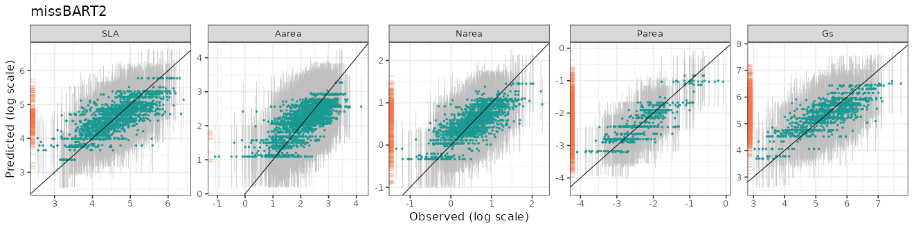

```{r, include = FALSE}
knitr::opts_chunk$set(collapse = TRUE, comment = "#>", echo = FALSE, message = FALSE,
                      warning = FALSE, fig.width = 8, fig.height = 4, dpi = 96)
library(ggplot2)
amax <- readRDS("results/global_amax.rds")
runs <- amax$runs
get <- function(model, seed) Filter(function(r) r$model == model && r$seed == seed, runs)[[1]]
responses <- get("missBART1", 1)$per_response$response
```

This article fits `missBART1()` and `missBART2()` to the *global Amax* data of
Maire et al. (2015), the application in Section 7 of Goh, Soh, Parnell and
Murphy (2024, [arXiv:2412.14946](https://arxiv.org/abs/2412.14946)), using
version `r amax$settings$version` of the package.

## The data

The data hold five leaf photosynthetic traits for `r amax$settings$n` plants,
together with `r amax$settings$q` soil and climate covariates. The traits are
specific leaf area (SLA), light-saturated photosynthetic rate (Aarea), leaf
nitrogen (Narea), leaf phosphorus (Parea) and stomatal conductance (Gs), all
modelled on the log scale. The covariates are complete, but most of the
responses are not:

```{r}
pr <- get("missBART1", 1)$per_response
knitr::kable(data.frame(Response = pr$response, Missing = pr$n_missing,
                        `Per cent missing` = round(100 * pr$n_missing / amax$settings$n, 1), check.names = FALSE))
```

The data are not distributed with the package, so this article shows posterior
summaries that were saved by
[`Examples/rerun_global_amax.R`](https://github.com/yongchengoh/missBART/blob/main/Examples/rerun_global_amax.R).

## Fitting the models

The settings are those of the paper: 5,000 burn-in and 5,000 kept iterations,
100 regression trees and 50 missingness trees.

```{r, echo = TRUE, eval = FALSE}
library(missBART)

data <- as.data.frame(readxl::read_excel("Maire_dataset_for_Andrew.xlsx", sheet = "Data"))
y <- as.matrix(log(data[, c("SLA", "Aarea", "Narea", "Parea", "Gs")]))
x <- as.matrix(data[, which(names(data) == "PPTmean"):ncol(data)])

set.seed(1)
fit1 <- missBART1(x, y, n_trees = 100, burn = 5000, iters = 5000, thin = 1)
fit2 <- missBART2(x, y, n_reg_trees = 100, n_class_trees = 50, burn = 5000, iters = 5000, thin = 1)
```

Each fit took about `r round(median(sapply(runs, function(r) r$seconds)) / 60, 1)`
minutes (with eight fits running at the same time).

## Fit to the observed responses

Each point is one observed response: its observed value is on the horizontal
axis and the posterior mean prediction of the model is on the vertical axis.
The grey vertical bars are the 95% prediction intervals, so a point is covered
when its bar crosses the diagonal line. The orange rug on the vertical axis
shows the posterior means of the imputed values for the missing responses,
which have no observed value to plot them against. The points fall in horizontal bands because plants
measured at the same site share the same covariates, and so the same
prediction. These plots correspond to Figure 5 of the paper, with the axes
swapped.

```{r, out.width = "100%"}
knitr::include_graphics("figures/amax_missBART1.png")

```

```{r}
p1 <- get("missBART1", 1)$per_response
p2 <- get("missBART2", 1)$per_response
knitr::kable(data.frame(Response = p1$response,
                        `RMSE, missBART1` = p1$rmse_observed, `RMSE, missBART2` = p2$rmse_observed,
                        `Coverage, missBART1` = p1$coverage_95, `Coverage, missBART2` = p2$coverage_95,
                        `SD of observed` = p1$sd_observed, check.names = FALSE),
             digits = 2, caption = "In-sample root mean squared error and coverage of the 95% prediction intervals for the observed responses (first seed).")
```

Both models fit the observed responses equally well, and the prediction
intervals have close to their nominal coverage. As the paper notes, the two
models differ in what they impute: `missBART2` imputes values within the range
of the observed data, while `missBART1` imputes values that are far from the
observed ones.

## How stable are the imputations?

Each model was run from four different seeds. The plot shows the average
imputed value of each response for each seed, next to the average of the
observed values (dashed line).

```{r stability, fig.height = 3.2}
st <- do.call(rbind, lapply(runs, function(r) {
  data.frame(model = r$model, seed = factor(r$seed), response = factor(r$per_response$response, levels = responses),
             imputed = r$per_response$mean_imputed, observed = r$per_response$mean_observed)
}))
ggplot(st, aes(seed, imputed, colour = model)) +
  geom_hline(aes(yintercept = observed), linetype = "dashed", linewidth = 0.3) +
  geom_point(position = position_dodge(width = 0.5), size = 2) +
  facet_wrap(~response, scales = "free_y", nrow = 1) +
  scale_colour_manual(values = c(missBART1 = "#709AE1", missBART2 = "#FD7446"), name = NULL) +
  labs(x = "Seed", y = "Mean imputed value (log scale)") +
  theme_bw() + theme(legend.position = "bottom")
```

The `missBART2` imputations stay close to the observed values and are
broadly similar across seeds (Parea, with 78% missing, varies the most). The
`missBART1` imputations are not: for SLA, Narea and Gs, one seed imputes values well
*above* the observed ones where the other seeds impute values well *below*,
or the other way around. Within a chain the imputations are stable (the two
halves of each chain agree), so each chain has settled in a different mode
and does not move between them in 10,000 iterations.

The same shows in the probit coefficients. The table gives the posterior mean
of the coefficient of each response in the model for its own missingness (a
positive value means that large values are more likely to be observed). It
includes four chains with the update of the missing responses used in the
paper (`ymis_update = "marginal"`), and four shorter chains with the original
R code of version 0.1.0, which takes about 29 minutes for 1,000 iterations on
these data.

```{r}
sens <- read.csv("results/global_amax_sensitivity.csv", check.names = FALSE)
own <- do.call(rbind, lapply(1:4, function(s) {
  data.frame(Version = "0.2.0, conditional update (default)", Iterations = amax$settings$burn + amax$settings$iters, Seed = s,
             t(diag(get("missBART1", s)$coef[responses, responses, "mean"])), check.names = FALSE)
}))
other <- sens[sens$quantity == "coefficient", c("version", "iterations", "seed", responses)]
names(other)[1:3] <- c("Version", "Iterations", "Seed")
own <- rbind(own, other, data.frame(Version = "Paper (Figure 6, read by eye)", Iterations = 10000, Seed = NA,
                                    SLA = -15, Aarea = -3, Narea = 5, Parea = 18, Gs = 13, check.names = FALSE))
options(knitr.kable.NA = "")
knitr::kable(own, digits = 1, row.names = FALSE, format.args = list(big.mark = ","))
```

Reading down the columns:

* **SLA** and **Parea** are consistent. In 11 of the 12 chains large values of
  SLA are more likely to be missing, and in 11 of 12 large values of Parea are
  more likely to be observed, as reported in the paper.
* **Narea** is not. The sign differs between chains of the original code, and
  most chains of the new code have the opposite sign to the paper.
* **Gs** depends on the update. The original code and the marginal update
  mostly agree with the paper (large values more likely to be observed), while
  three of the four chains with the conditional update settle on the opposite
  explanation.
* Aarea has only 12 missing values, so its coefficient is poorly determined.

So the multimodality is a property of the model on these data, and it is
present in the original code too. Which mode a chain finds depends on the
seed, and how often each mode is found depends on how the missing responses
are updated. Because the chains do not move between modes, their relative
posterior weights cannot be judged from these runs.

This is the well-known weak identifiability of selection models. With a
probit *regression* for the missingness, a response that is mostly missing can
be explained almost equally well by missing values that are all large or all
small, and the sampler cannot cross between the two explanations. The
practical consequences are:

* Conclusions about the *direction* of the missingness mechanism from
  `missBART1` on these data (for example, Figure 6 of the paper) are reliable
  for SLA and Parea, but depend on the chain for Narea and Gs.
* Several chains from different starting values should be run and compared
  before interpreting `missBART1` coefficients or imputations.
* `missBART2` is the safer choice here.

## Variable importance from missBART2

The ten predictors used most often in the missingness trees and in the
regression trees (first seed), as in Figure 7 of the paper.

```{r varimp, fig.height = 3.5}
r2 <- get("missBART2", 1)
top <- function(v, label) {
  v <- sort(v, decreasing = TRUE)[1:10]
  data.frame(trees = label, predictor = names(v), importance = as.numeric(v))
}
vi <- rbind(top(r2$varimp_missingness, "Missingness trees"), top(r2$varimp_regression, "Regression trees"))
vi$is_response <- vi$predictor %in% responses
ggplot(vi, aes(importance, reorder(paste(predictor, trees, sep = "___"), importance), fill = is_response)) +
  geom_col() + facet_wrap(~trees, scales = "free") +
  scale_y_discrete(labels = function(l) sub("___.*", "", l)) +
  scale_fill_manual(values = c("#1A9993", "#FD8CC1"), guide = "none") +
  labs(x = "Proportion of splitting rules", y = NULL) + theme_bw()
```

```{r}
rank_parea <- sapply(1:4, function(s) which(names(sort(get("missBART2", s)$varimp_missingness, decreasing = TRUE)) == "Parea"))
top3 <- sapply(1:4, function(s) paste(names(sort(get("missBART2", s)$varimp_missingness, decreasing = TRUE))[1:3], collapse = ", "))
```

As in the paper, exchangeable aluminium (ALU) is among the most important
predictors of the missingness and Parea is the response used most often in
the missingness trees. Across the four seeds Parea ranks
`r paste(rank_parea, collapse = ", ")` out of `r amax$settings$q + 5`
predictors, and the three most used predictors are: `r paste(top3, collapse = "; ")`.
The importances are spread thinly over many correlated covariates, so the
exact ordering varies from seed to seed.

## Reference

Maire, V. et al. (2015). Global effects of soil and climate on leaf
photosynthetic traits and rates. *Global Ecology and Biogeography*, 24(6),
706-717.
