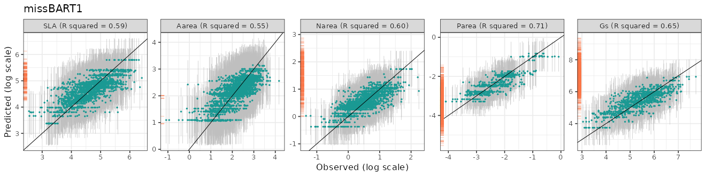
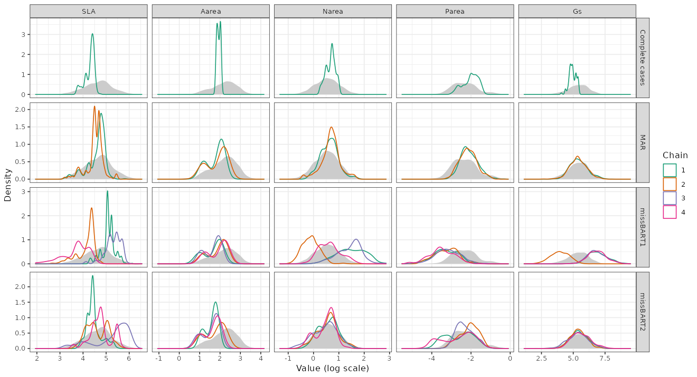

```{r, include = FALSE}
knitr::opts_chunk$set(collapse = TRUE, comment = "#>", echo = FALSE, message = FALSE,
                      warning = FALSE, fig.width = 8, fig.height = 4, dpi = 96)
library(ggplot2)
amax <- readRDS("results/global_amax.rds")
set <- amax$settings
m1 <- amax$missBART1
m1m <- amax$missBART1_marginal
m2 <- amax$missBART2
mar <- amax$MAR
cc <- amax$complete_cases
responses <- m1$per_response$response
options(knitr.kable.NA = "")
clean <- theme_bw() + theme(strip.background = element_blank(), panel.grid.minor = element_blank())
```

This article fits `missBART1()` and `missBART2()` to the *global Amax* data of
Maire et al. (2015), the application in Section 7 of Goh, Soh, Parnell and
Murphy (2024, [arXiv:2412.14946](https://arxiv.org/abs/2412.14946)), using
version `r set$version` of the package. It also compares them with the same
response model fitted under the assumption that the missingness can be
ignored.

## The data

The data hold five leaf photosynthetic traits for `r set$n` plants, together
with `r set$q` soil and climate covariates. The traits are specific leaf area
(SLA), light-saturated photosynthetic rate (Aarea), leaf nitrogen (Narea),
leaf phosphorus (Parea) and stomatal conductance (Gs), all modelled on the log
scale. The covariates are complete, but most of the responses are not, and
only `r set$n_complete` plants have all five:

```{r}
pr <- m1$per_response
knitr::kable(data.frame(Response = pr$response, Missing = pr$n_missing,
                        `Per cent missing` = round(100 * pr$n_missing / set$n, 1), check.names = FALSE))
```

The data are not distributed with the package, so this article shows posterior
summaries that were saved by
[`Examples/rerun_global_amax.R`](https://github.com/yongchengoh/missBART/blob/main/Examples/rerun_global_amax.R).

## Fitting the models

The settings are those of the paper: 5,000 burn-in and 5,000 kept iterations,
100 regression trees and 50 missingness trees. Each model is run as four
chains from different starting values, and the trees are kept so that partial
dependence curves can be computed afterwards.

```{r, echo = TRUE, eval = FALSE}
library(missBART)

data <- as.data.frame(readxl::read_excel("Maire_dataset_for_Andrew.xlsx", sheet = "Data"))
y <- as.matrix(log(data[, c("SLA", "Aarea", "Narea", "Parea", "Gs")]))
x <- as.matrix(data[, which(names(data) == "PPTmean"):ncol(data)])

fit1 <- missBART1(x, y, n_trees = 100, burn = 5000, iters = 5000, thin = 1,
                  n_chains = 4, cores = 4, keep_trees = TRUE)
fit2 <- missBART2(x, y, n_reg_trees = 100, n_class_trees = 50, burn = 5000, iters = 5000, thin = 1,
                  n_chains = 4, cores = 4, keep_trees = TRUE)

# the same response model, with the missingness assumed ignorable (MAR)
fit_mar <- missBART1(x, y, n_trees = 100, burn = 5000, iters = 5000, thin = 1,
                     include_y = FALSE, n_chains = 2, cores = 2, keep_trees = TRUE)
```

Four chains of `missBART1` took `r round(m1$seconds / 60, 1)` minutes and four
chains of `missBART2` `r round(m2$seconds / 60, 1)` minutes, with the chains
of each model run in parallel.

## Fit to the observed responses

Each point is one observed response: its observed value is on the horizontal
axis and the posterior mean prediction of the model is on the vertical axis.
The grey vertical bars are the 95% prediction intervals, so a point is covered
when its bar crosses the diagonal line. The orange rug on the vertical axis
shows the posterior means of the imputed values for the missing responses,
which have no observed value to plot them against. The points fall in
horizontal bands because plants measured at the same site share the same
covariates, and so the same prediction. These plots correspond to Figure 5 of
the paper, with the axes swapped (first chain of each model).

```{r, out.width = "100%"}

knitr::include_graphics("figures/amax_missBART2.png")
```

```{r}
knitr::kable(data.frame(Response = responses,
                        `missBART1` = m1$per_response$rmse_observed, `missBART2` = m2$per_response$rmse_observed,
                        `MAR` = mar$per_response$rmse_observed, `Complete cases` = cc$rmse_observed,
                        `Coverage, missBART1` = m1$per_response$coverage_95, `Coverage, missBART2` = m2$per_response$coverage_95,
                        `SD of observed` = m1$per_response$sd_observed, check.names = FALSE),
             digits = 2, caption = "Root mean squared error for the observed responses, and coverage of the 95% prediction intervals.")
```

The three models that use every row fit the observed responses equally well,
and the prediction intervals have close to their nominal coverage. The
complete case model is fitted to `r set$n_complete` plants only, so most of
its error is out of sample. The observed responses alone therefore cannot tell
the three models apart; they differ in what they say about the *missing*
responses.

## What is imputed

The grey area in each panel is the distribution of the observed values of a
response. The lines are the distributions of the imputed values (posterior
means), one line per chain.

```{r, out.width = "100%"}

```

```{r}
imp_mean <- function(res) {
  t(sapply(sort(unique(res$imputed$chain)), function(k) {
    tapply(res$imputed$value[res$imputed$chain == k], res$imputed$response[res$imputed$chain == k], mean)
  }))
}
row_of <- function(label, chain, m) { d <- data.frame(Model = label, Chain = chain, m); names(d)[3:7] <- responses; d }
tab <- rbind(row_of("Observed values", NA, t(m1$per_response$mean_observed)),
             row_of("Complete cases", NA, imp_mean(cc)),
             row_of("MAR", seq_len(nrow(imp_mean(mar))), imp_mean(mar)),
             row_of("missBART2", 1:4, imp_mean(m2)),
             row_of("missBART1", 1:4, imp_mean(m1)))
knitr::kable(tab, digits = 2, row.names = FALSE, caption = "Mean of the observed values, and mean of the imputed values in each chain.")
```

* Under MAR the imputations are predictions from the covariates and the
  observed responses of the same plant, so they sit inside the observed
  distribution, and the two chains agree closely.
* `missBART2` stays fairly close to MAR, but its chains differ from each
  other more than the MAR chains do.
* `missBART1` imputes values far from the observed ones, and its chains
  disagree about the direction: for most responses some chains impute values
  well *above* the observed ones and others well *below*.

## How stable are the fits?

`chain_diagnostics()` compares the chains. The potential scale reduction
factor (R-hat) should be close to 1. The second table gives the same
information in more tangible units: the difference between the largest and
smallest chain mean, in standard deviations of the observed response.

```{r}
rh <- function(res) res$diagnostics$rhat[paste("mean imputed", responses)]
knitr::kable(data.frame(Model = c("MAR", "missBART2", "missBART1"), rbind(rh(mar), rh(m2), rh(m1)), check.names = FALSE),
             digits = 2, col.names = c("Model", responses), row.names = FALSE,
             caption = "R-hat of the mean imputed value of each response.")
```

```{r}
spread <- function(res) apply(imp_mean(res), 2, function(v) diff(range(v))) / m1$per_response$sd_observed
knitr::kable(data.frame(Model = c("MAR", "missBART2", "missBART1"), rbind(spread(mar), spread(m2), spread(m1)), check.names = FALSE),
             digits = 2, col.names = c("Model", responses), row.names = FALSE,
             caption = "Range of the mean imputed value across chains, in standard deviations of the observed response.")
```

The chains of `missBART1` differ by several standard deviations for some
responses. Within a chain the imputations are stable, so each chain has
settled in a different mode and does not move between them in 10,000
iterations. The `missBART2` chains are much closer to each other, but they
have not converged to a common answer either (the R-hat of a mean over
hundreds of imputed values is a strict measure, because that mean varies very
little within a chain).

The same shows in the probit coefficients. The table gives the posterior mean
of the coefficient of each response in the model for its own missingness. A
positive value means that large values are more likely to be *missing*. The
paper used the opposite coding, so the signs of its values are reversed here
to match. The table includes four chains with the update of the missing
responses described in the paper (`ymis_update = "marginal"`), and four
shorter chains with the original R code of version 0.1.0, which takes about
29 minutes for 1,000 iterations on these data.

```{r}
own_coef <- function(res, label) data.frame(Version = label, Iterations = set$burn + set$iters, Chain = seq_len(nrow(res$own_coef)),
                                            res$own_coef, check.names = FALSE)
orig <- read.csv("results/global_amax_original.csv", check.names = FALSE)
orig <- orig[orig$quantity == "coefficient", c("version", "iterations", "seed", responses)]
names(orig)[1:3] <- c("Version", "Iterations", "Chain")
paper <- c(SLA = 15, Aarea = 3, Narea = -5, Parea = -18, Gs = -13)
chains <- rbind(own_coef(m1, paste0(set$version, ", conditional update")), own_coef(m1m, paste0(set$version, ", marginal update")), orig)
own <- rbind(chains, data.frame(Version = "Paper (Figure 6, read by eye, sign reversed)", Iterations = 10000, Chain = NA,
                                t(paper), check.names = FALSE))
knitr::kable(own, digits = 1, row.names = FALSE, format.args = list(big.mark = ","))
```

The number of chains, out of four, whose coefficient has the same sign as in
the paper:

```{r}
agree <- do.call(rbind, lapply(unique(chains$Version), function(v) {
  data.frame(Version = v, t(sapply(responses, function(r) sum(sign(chains[[r]][chains$Version == v]) == sign(paper[r])))), check.names = FALSE)
}))
names(agree)[-1] <- responses
knitr::kable(agree, row.names = FALSE)
```

The chains of every version disagree with each other for at least one
response. Where the original code and the marginal update agree with the paper
more often than the conditional update does, that is not evidence for the
direction reported in the paper, because the conditional update is the correct
full conditional distribution.

So the multimodality is a property of the model on these data, and it is
present in the original code too. Which mode a chain finds depends on its
starting values, and how often each mode is found depends on how the missing
responses are updated. Because the chains do not move between modes, their
relative posterior weights cannot be judged from these runs.

This is the well-known weak identifiability of selection models. With a
probit *regression* for the missingness, a response that is mostly missing can
be explained almost equally well by missing values that are all large or all
small, and the sampler cannot cross between the two explanations. The
practical consequences are:

* Conclusions about the *direction* of the missingness mechanism from
  `missBART1` on these data (for example, Figure 6 of the paper) depend on the
  chain, and should not be drawn from a single run.
* Several chains should be run and compared (`n_chains`) before interpreting
  the coefficients or imputations of either model.
* `missBART2` is the safer choice here, because its chains differ far less,
  but its imputations should still be reported with their between-chain
  variation.

## Does modelling the missingness change the conclusions?

The partial dependence of each response on soil pH, one of the covariates
highlighted in the paper (its Figure 9), under MAR and under the two joint
models. The lines are posterior means and the bands 95% intervals, pooled over
chains.

```{r pdp-ph, fig.height = 3.2, fig.width = 9}
pd <- rbind(cbind(model = "MAR", mar$pdp_pH), cbind(model = "missBART1", m1$pdp_pH), cbind(model = "missBART2", m2$pdp_pH))
pd$response <- factor(pd$response, levels = responses)
cols <- c(MAR = "grey30", missBART1 = "#709AE1", missBART2 = "#FD7446")
ggplot(pd, aes(grid, mean, colour = model, fill = model)) +
  geom_ribbon(aes(ymin = lower, ymax = upper), alpha = 0.2, colour = NA) +
  geom_line() +
  facet_wrap(~response, scales = "free_y", nrow = 1) +
  scale_colour_manual(values = cols, name = NULL) + scale_fill_manual(values = cols, name = NULL) +
  labs(x = "Soil pH", y = "Predicted response (log scale)") +
  clean + theme(legend.position = "bottom")
```

```{r}
vi_cor <- function(a, b) cor(colMeans(a$varimp_regression), colMeans(b$varimp_regression), method = "spearman")
top <- function(res) names(sort(colMeans(res$varimp_regression), decreasing = TRUE))[1:10]
shift <- function(res) {
  a <- tapply(res$pdp_pH$mean, res$pdp_pH$response, mean)[responses]
  b <- tapply(mar$pdp_pH$mean, mar$pdp_pH$response, mean)[responses]
  (a - b) / m1$per_response$sd_observed
}
```

The curves average over all plants, including those whose response is missing,
and the models disagree about those. Measured in standard deviations of the
observed response, the average shift of each curve relative to MAR is:

```{r}
knitr::kable(data.frame(Model = c("missBART1", "missBART2"), rbind(shift(m1), shift(m2)), check.names = FALSE),
             digits = 2, col.names = c("Model", responses), row.names = FALSE)
```

The covariates used by the regression trees are broadly similar across the
models. The rank correlation of the variable importances with those under MAR
is `r round(vi_cor(m1, mar), 2)` for `missBART1` and `r round(vi_cor(m2, mar), 2)`
for `missBART2`, and `r length(intersect(top(m1), top(mar)))` and
`r length(intersect(top(m2), top(mar)))` of the ten most important covariates
are shared.

## Missingness probabilities

The partial dependence of the probability that each response is missing on the
value of Parea, as in Figure 10 of the paper (which showed the probability of
being observed). One line per chain.

```{r pdp-missing, fig.height = 4.5, fig.width = 9}
pm <- rbind(cbind(model = "missBART1", m1$pdp_missing_Parea), cbind(model = "missBART2", m2$pdp_missing_Parea))
pm$response <- factor(pm$response, levels = responses)
ggplot(pm, aes(grid, mean, colour = factor(chain), group = chain)) +
  geom_line() +
  facet_grid(model ~ response) +
  scale_colour_brewer(palette = "Dark2", name = "Chain") +
  labs(x = "Parea (log scale)", y = "Probability of being missing") + ylim(0, 1) +
  clean + theme(legend.position = "bottom")
```

For `missBART1`, the curve for the missingness of Parea itself is steep and
the same in every chain: plants with low Parea are much more likely to have it
missing. The curves for the other responses differ between chains, in line
with the coefficients above. The `missBART2` curves are flatter and show the
same direction for Parea in the chains where there is any effect.

## Variable importance and interactions from missBART2

The ten predictors used most often in the missingness trees and in the
regression trees (averaged over chains), as in Figure 7 of the paper.

```{r varimp, fig.height = 3.5}
top_df <- function(v, label) {
  v <- sort(colMeans(v), decreasing = TRUE)[1:10]
  data.frame(trees = label, predictor = names(v), importance = as.numeric(v))
}
vi <- rbind(top_df(m2$varimp_missingness, "Missingness trees"), top_df(m2$varimp_regression, "Regression trees"))
vi$is_response <- vi$predictor %in% responses
ggplot(vi, aes(importance, reorder(paste(predictor, trees, sep = "___"), importance), fill = is_response)) +
  geom_col() + facet_wrap(~trees, scales = "free_y") +
  scale_y_discrete(labels = function(l) sub("___.*", "", l)) +
  scale_fill_manual(values = c("#1A9993", "#FD8CC1"), guide = "none") +
  labs(x = "Proportion of splitting rules", y = NULL) + clean
```

```{r}
ranked <- lapply(1:4, function(k) names(sort(m2$varimp_missingness[k, ], decreasing = TRUE)))
rank_of <- function(v) paste(sapply(ranked, function(r) which(r == v)), collapse = ", ")
top3 <- paste(sapply(ranked, function(r) paste(r[1:3], collapse = ", ")), collapse = "; ")
```

The importance is the proportion of splitting rules that use a predictor,
averaged over the posterior samples. It is spread thinly over many correlated
covariates, so the ordering varies from chain to chain. Across the four
chains, the three most used predictors in the missingness trees are: `r top3`.
Exchangeable aluminium (ALU), which the paper found to be the most important
predictor of the missingness, ranks `r rank_of("ALU")` out of `r set$q + 5`.
Parea, the only response among the top ten in the paper, ranks
`r rank_of("Parea")`. A response can also be used in the missingness trees
simply because it is correlated with the covariates, so its importance is not
by itself evidence that the data are missing not at random.

`interactions()` counts how often two predictors are used in consecutive
splitting rules on the same branch, as in Figure 8 of the paper. For the ten
most important predictors of the regression trees (first chain):

```{r interactions, fig.height = 4.2, fig.width = 5.5}
int <- m2$interactions_regression
keep <- names(sort(diag(int), decreasing = TRUE))[1:10]
sub <- int[keep, keep]
diag(sub) <- NA
df <- data.frame(a = factor(rep(keep, 10), levels = keep), b = factor(rep(keep, each = 10), levels = rev(keep)), pairs = c(sub))
ggplot(df, aes(a, b, fill = pairs)) + geom_tile() +
  scale_fill_gradient(low = "white", high = "#1A9993", na.value = "grey90", name = "Pairs per\nsample") +
  labs(x = NULL, y = NULL) + clean + theme(axis.text.x = element_text(angle = 45, hjust = 1))
```

## Reference

Maire, V. et al. (2015). Global effects of soil and climate on leaf
photosynthetic traits and rates. *Global Ecology and Biogeography*, 24(6),
706-717.
